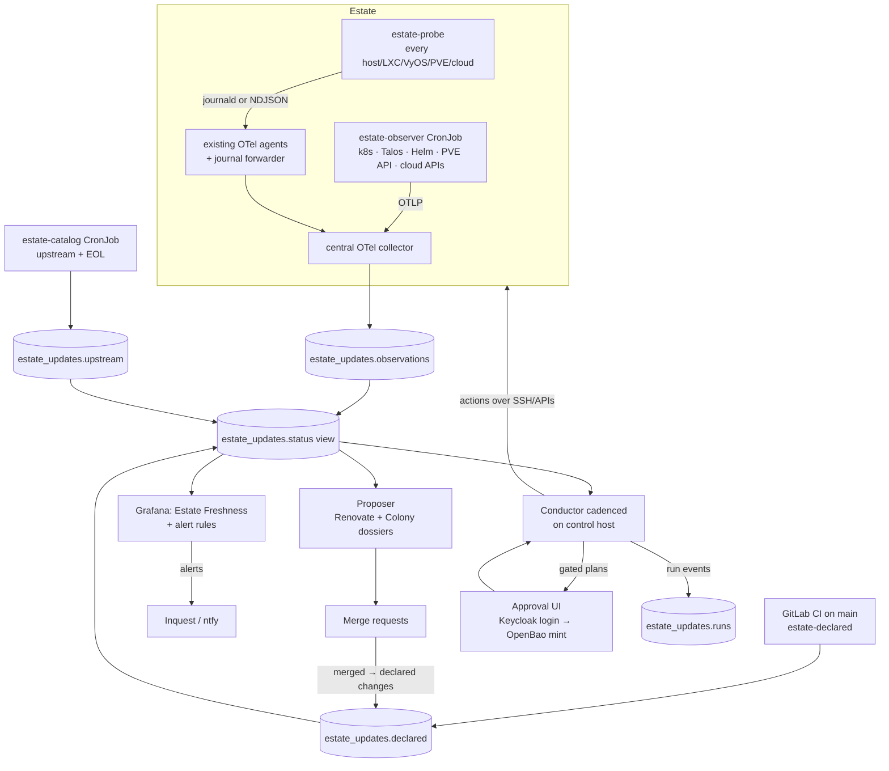
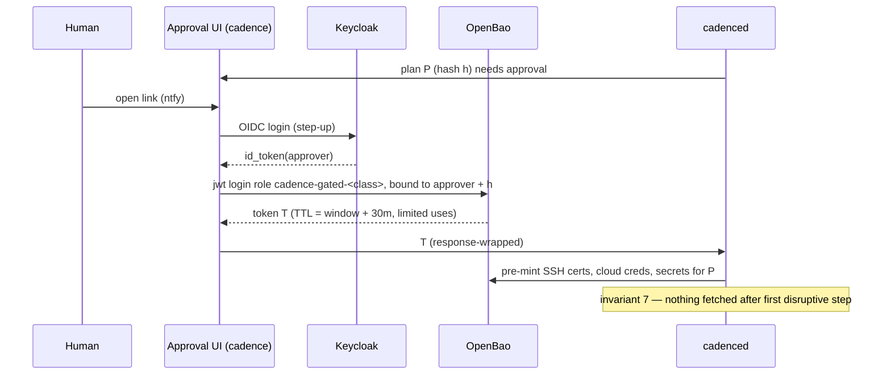

# Estate Updates (Cadence) — Design Spec

Status: **design, awaiting review** (2026-10-30). Supersedes
[patch-management.md](patch-management.md).

Cadence is the estate-wide update system: it **observes** what every host and
workload is actually running, **proposes** version changes as merge requests,
and **applies** them inside maintenance windows with deterministic health
gates and rollback. Agents research and plan; code executes and verifies.

## 1. Why — evidence from 2026-10-30

One evening of looking found every failure class this system must prevent:

| Finding | Class | Would have been caught by |
| --- | --- | --- |
| VyOS running `2025.08.02-rolling`; repo pin bumped to `2026.07.28` on 2026-08-15 (cf3e381) and never applied | declared ≠ running | Observer `DECLARED_NOT_APPLIED` |
| NixOS hosts built from `nixos-25.11` locked 2026-01-03; the release is past support | EOL / stale lock | Observer `EOL`, `BEHIND` |
| AWS gateway on AL2023 `2023.11.20260413`, 26 weeks uptime, no update mechanism, SSH open to the internet | unmanaged OS | Observer `BEHIND` + policy gap |
| OCI box: security updates installed but running kernel 6.17.0-1011 with six newer kernels installed (15 weeks) | installed ≠ running | Observer `PENDING_ACTIVATION` |
| GCP box: same, five kernels behind | installed ≠ running | Observer `PENDING_ACTIVATION` |
| `dnf --releasever=latest check-update` OOM-wedged the 1 GB AWS box twice (~26 min public outage) | unsafe operation on a constrained host | Conductor resource guard; probe never refreshes metadata |
| `task provision:router` from a laptop on VLAN 4 would delete the router the laptop routes through, mid-playbook, with SOPS needing OpenBao behind that router | controller cuts its own path | Conductor path invariant + credential pre-mint |

## 2. Goals and non-goals

Goals:

1. Every update-bearing **subject** in the estate has an observed running
   version, a declared version (where one exists), the latest version on its
   track, and an EOL date — in ClickHouse, alertable in Grafana.
2. Routine version bumps arrive as merge requests without anyone remembering
   to look. Hard bumps arrive with a researched dossier.
3. Approved changes are applied in windows by a conductor that cannot cut its
   own path, snapshots before mutating, gates on real health, and rolls back
   on failure.
4. Low-risk classes run unattended; single points of failure and stateful or
   cross-version changes always require a human approval that mints the
   credentials for that one run.
5. Long-lived Fedora VMs/LXCs converge on NixOS, so OS updates collapse into
   one declarative, generation-rollback class (`nixos-lock` / `nixos-release`).

Non-goals:

- General infrastructure CD (new services, topology changes). Those keep the
  existing `task` workflow. Cadence owns **version changes** of things that
  already exist.
- Replacing Trivy for in-cluster CVE scanning. Cadence consumes its signal.
- Image-level vulnerability scanning of VM/LXC root filesystems (deferred;
  pending-security-update counts from package managers are the Phase 1 signal).

## 3. Design invariants

These are hard rules, enforced in code (plan validator, probe, conductor), not
conventions:

1. **Running beats declared.** A merged MR is not an applied change. Status is
   always computed from observed state.
2. **Installed is not running.** Kernel, VyOS image, NixOS generation and
   container digest are compared at the running level.
3. **Observation is cheap and safe.** Probes read cached package metadata only
   (`dnf -C`, apt's existing lists, `dnf check-release-update`), run under
   `MemoryMax=128M`, `CPUQuota=20%`, `Nice=19`, and never trigger a metadata
   refresh. Distro timers own refresh.
4. **No mutation without a snapshot or a declared reason why none is needed.**
5. **Every mutating step has a gate and an undo.** A step without an automatic
   undo (e.g. restoring from snapshot) is escalation-only and must be marked so.
6. **The conductor never cuts its own path.** For each step that disrupts a
   subject, every host the conductor must reach afterwards (including for
   rollback) must be reachable by a path that does not traverse that subject.
7. **All credentials and secrets for a run are minted before the first
   disruptive step.** Nothing is fetched after the point of disruption.
8. **Resource guard.** Package operations on hosts with < 2 GiB RAM run with
   temporary swap and a memory ceiling on the package manager.
9. **One disruptive operation per failure domain at a time.** Redundant pairs
   (e.g. both AdGuards) are never in flight together.
10. **Missing data is not health.** A subject with no fresh observation is
    `STALE`, never `CURRENT`.

## 4. Architecture



Four components, built in order, each independently useful:

| # | Component | Runs where | Agentic? |
| --- | --- | --- | --- |
| 1 | Observer | probes on hosts; CronJobs in k8s; CI publisher | No |
| 2 | Proposer | Renovate (GitLab CI schedule); Colony scopes | Hard bumps only |
| 3 | Conductor | `cadenced` on a dedicated control host | Plan drafting only |
| 4 | Policy | `config/updates.yml` in this repo | No |

Code lives in a new Rust workspace `so/cadence` following the in-house
conventions (`crates/*` + `bins/*`, edition 2024, pinned toolchain, released as
versioned GitLab generic packages with sha256, consumed by aether under the
existing pinned-release contract — see `ansible/roles/vyos_exporter/tasks/main.yml`).
Aether owns deployment, schemas, policy, alerting and credentials.

## 5. Subject model

A **subject** is one versioned thing on one target:

```
subject_id  = "<target>/<kind>[/<name>]"
              e.g. "link/os", "link/kernel", "router/vyos-image",
                   "adguard/nixos-generation", "k8s/immich/image/server",
                   "k8s/chart/cilium", "talos/os", "talos/kubernetes"
```

| Kind | Observed from | Declared in | Upstream track source |
| --- | --- | --- | --- |
| `os` (release) | probe: `/etc/os-release`, AL2023 release, PVE `pveversion` | tofu image/blueprint, `ansible/roles/dnf` releasever | endoflife.date; AL2023 `dnf check-release-update` |
| `kernel` | probe: running vs newest installed | — | distro (pending count) |
| `packages` | probe: pending / pending-security counts (cached metadata) | — | distro |
| `vyos-image` | probe on router: `show version` | `pack_vyos.yml` ISO URL | GitHub `vyos/vyos-nightly-build` releases |
| `nixos-generation` | probe: running `configurationRevision`, nixpkgs rev, booted vs current system | `flake.lock` | channel head (`channels.nixos.org/<ch>/git-revision`), endoflife.date |
| `talos-os`, `kubernetes` | Talos/k8s API | `cloud_images.tf`, `talos_cluster.tf` | GitHub releases; `dl.k8s.io/release/stable.txt` |
| `chart` | Helm release metadata | `helm_release.version` | chart repo `index.yaml` |
| `image` | k8s pod status / `podman ps` digests | tofu/ansible image refs | registry tag → digest |
| `binary` | probe: in-house binary `--version` | role defaults (`vyos_exporter_version` etc.) | GitLab package registry |
| `firmware`/`appliance` (Gigahub, JetKVM) | out of scope until an API exists | — | — |
| `platform` | probe: OS family (`fedora`, `nixos`, …) | policy `platform_target` | — |

Each subject resolves, via policy, to a **class** (`os-patch`, `os-release`,
`kernel-activation`, `nixos-lock`, `nixos-release`, `vyos`, `talos`,
`kubernetes`, `chart`, `image-stateless`, `image-stateful`, `binary`), a
**tier** (`auto` | `gated`), a **track**, a **window**, and **staleness SLOs**.

## 6. Policy — `config/updates.yml`

Single declarative source read by all components. Example (abridged):

```yaml
windows:
  nightly: { cron: "0 4 * * *", duration: 2h, tz: America/Toronto }
  weekly:  { cron: "0 22 * * SAT", duration: 3h, tz: America/Toronto }
blackouts:
  - { name: pbs-nightly, cron: "0 2 * * *", duration: 90m }

failure_domains:          # invariant 9
  dns-lan: [adguard, adguard-secondary]

topology:                 # invariant 6: what each target's traffic transits
  router:   { carries: [vlan2, vlan3, vlan4, wan] }
  link:     { carries: [wg-hub, public-ingress] }
  conductor_paths:        # how cadenced reaches each target
    default: [vlan2]
    gigahub_side: [router, proxmox-hosts, pbs, cloud]

classes:
  os-patch:
    tier: auto
    window: nightly
    slo: { security_pending_max_age: 7d }
    gates: [ssh, systemd-units, http-probes]
  kernel-activation:
    tier: auto
    window: nightly
    slo: { pending_activation_max_age: 7d }
  nixos-lock:
    tier: auto            # same channel only; canary first
    canary: nix-builder
    window: nightly
    slo: { behind_channel_max_age: 30d }
  nixos-release: { tier: gated, slo: { eol_warning: 60d } }
  vyos:          { tier: gated, track: rolling, slo: { behind_max_age: 60d } }
  talos:         { tier: gated, track: patch }
  kubernetes:    { tier: gated, track: patch }
  image-stateless: { tier: auto, window: nightly }
  image-stateful:  { tier: gated }

target_defaults:
  platform_target: nixos   # guests excluded in §14 override this

targets:
  link:            { class_overrides: { os-patch: gated }, spof: true, ram_mib: 1024 }
  vigilant:        { ram_mib: 969 }
  rama:            {}
  router:          { spof: true }
  home-gateway-stack: { spof: true, class_overrides: { os-patch: gated } }
  keycloak:        { spof: true, class_overrides: { os-patch: gated } }
  step-ca:         { spof: true, class_overrides: { os-patch: gated } }
  openbao:         { spof: true, class_overrides: { os-patch: gated } }
  monitoring-stack: { spof: true, class_overrides: { os-patch: gated } }

declared:                 # extractors for the declared publisher
  router/vyos-image: { file: ansible/playbooks/home_router/pack_vyos.yml, regex: 'vyos-(?P<v>[0-9.]+-[0-9]+-rolling)-generic' }
  talos/os:          { file: tofu/home/cloud_images.tf, hcl_local: talos_version }
  talos/kubernetes:  { file: tofu/home/talos_cluster.tf, hcl_local: kubernetes_version }
  "*/nixos-generation": { file: flake.lock, json: .nodes.nixpkgs.locked.rev }
```

Validation: a CI job loads the file with the `cadence-policy` crate and fails
on unknown classes/targets, targets missing from `ansible/inventory/hosts.yml`
/ tofu, overlapping failure domains, and windows that intersect blackouts.

## 7. Component 1 — Observer

### 7.1 `estate-probe` (host side)

Static Rust binary, one run per timer tick (hourly), emits one JSON envelope
per subject. Collectors per platform:

| Platform | Facts |
| --- | --- |
| Fedora (dnf) | os-release, running vs newest `kernel`, `needs-restarting -r`, `dnf -C updateinfo --security` count, `dnf -C check-update` count, last transaction time |
| Debian/Ubuntu (apt) | os-release, running vs newest `linux-image-*`, `/var/run/reboot-required(.pkgs)`, `apt-get -s upgrade` counts split by `-security` origin (existing lists only), last `history.log` upgrade |
| AL2023 | release, `dnf check-release-update` (no `--releasever=latest`), kernel running vs installed |
| NixOS | `nixos-version --json` (`configurationRevision`, nixpkgs rev), `/run/booted-system` vs `/run/current-system` |
| Proxmox VE | `pveversion -v` (pve-manager, kernel), apt facts as Debian |
| VyOS | `show version`, installed images, default boot image |
| any | podman container image digests, in-house binary versions |

Envelope (shared crate `cadence-envelope`):

```json
{"v":1,"observed_at":"2026-10-30T23:40:00Z","target":"rama","subject":"rama/kernel",
 "kind":"kernel","running":"7.0.0-1013-oracle","installed":"7.0.0-1013-oracle",
 "pending":0,"pending_security":0,"reboot_required":false,"probe_version":"0.1.0",
 "facts":{"os":"ubuntu-24.04"}}
```

Transport reuses existing pipes, no new agents:

- Default: write each envelope as one structured journald entry with
  `SYSLOG_IDENTIFIER=estate-probe`. Already shipped by
  `vm_monitoring_agent` (VMs/LXCs), `otel-agent.nix` (NixOS), the journal
  forwarder (Proxmox hosts and cloud boxes — `monitoring_stack/journal_forwarder.yml`).
- VyOS: NDJSON under `/config/estate-probe/observations/`, tailed by the
  router's collector exactly like `router-drift` (`home_router/templates/otel-collector-config.yml.j2`).

Deployment: ansible role `estate_probe` (pinned version + sha256 assert),
NixOS module `nix/modules/estate-probe.nix`, VyOS task-scheduler entry in
`configure_router.yml`. Probe coverage itself is observed: the status view
lists inventory targets with no observation as `STALE`.

### 7.2 `estate-observer` (platform side)

k8s CronJob (every 30 min), same envelope via OTLP to the central collector:
Talos node versions (Talos API, read-only role), k8s version, every pod's
image ref + resolved digest, Helm release chart versions, Proxmox guest list
(PVE API token, `PVEAuditor`) to detect undeclared guests, cloud instance
metadata (Lightsail blueprint/bundle, GCE image, OCI image).

### 7.3 `estate-declared` (repo side)

Runs in GitLab CI on every merge to `main` and via `task publish:estate-declared`
(mirrors `publish:router-declared`). Applies the `declared:` extractors in
policy plus generic extraction of `helm_release.version` and image refs from
`tofu/home/kubernetes/*.tf`, writes rows with the commit SHA.

### 7.4 `estate-catalog` (upstream side)

k8s CronJob (every 6 h): latest version per track and EOL dates. Sources in
the table in §5. Products not on endoflife.date take `eol:` from policy.
Registry lookups resolve tags → digests so `:latest` workloads become
comparable.

### 7.5 ClickHouse schema

New file `ansible/playbooks/monitoring_stack/clickhouse/20-estate-updates.sql`,
same reconcile pattern as `09-vyos-observations.sql`:

| Table | Engine / key | Retention |
| --- | --- | --- |
| `estate_updates.observations` | MergeTree, `(subject, observed_at)` | 180 d |
| `estate_updates.declared` | ReplacingMergeTree(`published_at`), `(subject)` + history table | forever (small) |
| `estate_updates.upstream` | ReplacingMergeTree(`fetched_at`), `(track_id)` | 365 d |
| `estate_updates.runs`, `run_events` | MergeTree, `(run_id, ts)` | 730 d |
| `estate_updates.status` | view: latest observation ⨝ declared ⨝ upstream ⨝ policy dictionary | — |

`grafana_readonly` gets SELECT on `estate_updates`; writers are the central
collector identity and the CI/CronJob identities.

### 7.6 Status states

Computed per subject, most severe wins:

| State | Condition |
| --- | --- |
| `STALE` | no observation within 2 × expected interval |
| `EOL` / `EOL_SOON` | track EOL passed / within `eol_warning` |
| `DECLARED_NOT_APPLIED` | declared ≠ running for > 24 h after the declared row |
| `PENDING_ACTIVATION` | installed ≠ running (kernel, image, generation) for > SLO |
| `SECURITY_PENDING` | `pending_security > 0` for > SLO |
| `BEHIND` | upstream newer on track for > SLO |
| `UNMANAGED` | observed subject or guest with no policy entry |
| `MIGRATION_PENDING` | informational: observed `platform` ≠ policy `platform_target` (§14) |
| `CURRENT` | none of the above |

### 7.7 Alerting and dashboard

Grafana rules in `tofu/home/kubernetes/grafana/alerting/rules/estate-updates.yml`
(one rule per state family, labels `target`, `class`, `tier`, `spof`), routed
via existing contact points; `spof=true` + `EOL|SECURITY_PENDING` routes to
Inquest. Dashboard **Estate Freshness**: estate grid (target × class coloured
by state), age-behind histogram, EOL timeline, pending-activation list, probe
coverage.

## 8. Component 2 — Proposer

### 8.1 Mechanical bumps — Renovate

Self-hosted Renovate as a scheduled GitLab CI job on `so/aether` (Renovate and
diun were decommissioned earlier — `docs/namespace-strategy.md` Appendix A;
the reason is not recorded, so this reintroduction is deliberately narrow):

- Managers: `terraform` (providers, `helm_release`), `ansible-galaxy`
  (`ansible/requirements.yml`), `nix` (`flake.lock`, same-channel only),
  custom regex managers for `pack_vyos.yml`, `talos_version`,
  `kubernetes_version`, in-house binary pins, image refs in `*.tf`/quadlets.
- Noise control: weekly schedule, grouped MRs per class, `minor`/`major`
  disabled for `gated` classes (handed to 8.2), dependency dashboard issue.
- Every Renovate MR carries labels `cadence/class:*`, `cadence/tier:*`.

### 8.2 Hard bumps — Colony dossiers

Triggered when the status view shows `BEHIND`/`EOL_SOON` for a `gated` class
or a minor/major jump: a Kestra flow opens a Colony scope (approvals manual)
whose goal is a single MR containing the pin change plus
`docs/updates/<date>-<subject>.md`:

- changelog digest between running and target (primary sources only),
- each breaking change checked against **live** config evidence
  (e.g. `show configuration commands` for VyOS, rendered tofu for charts),
- applicability of announced CVEs to this estate's configuration,
- the draft conductor plan (§9.4) and rollback,
- open risks requiring a human decision.

This is the 2026-10-30 VyOS analysis, made repeatable.

## 9. Component 3 — Conductor

### 9.1 Control host

`cadence` — NixOS VM on **niobe** (not oracle, which hosts the router), local
disk (no Ceph dependency), two legs: `vmbr0` on the Gigahub segment
(`192.168.2.0/24`, internet via the Gigahub's own uplink) and a VLAN 2 leg
(L2-adjacent to OpenBao/step-ca without transiting VyOS). Declared in
`config/vm.yml` + `tofu/home/cadence.tf`, NixOS config in
`nix/hosts/niobe/cadence/`. It survives router, k8s and Ceph outages by
construction; it is itself patched by `nixos-lock` like any NixOS host, but
never by its own conductor mid-run (self-update only between runs).

### 9.2 Identity and credentials



- **Standing (auto tier):** machine cert auth (existing
  `tofu/home/openbao_machine_auth.tf` pattern) → policy `cadence-auto`:
  SSH cert signing for principal `cadence-auto` only; hosts in auto tier list
  that principal in `AuthorizedPrincipals` with a forced command allowlist;
  read-only APIs; PBS snapshot trigger.
- **Gated:** per-run tokens as above, policy per class
  (`cadence-gated-vyos`, `-os-spof`, `-talos`, `-pve`, `-cloud`, `-tofu`).
  The control host holds no standing rights over gated targets.
- Every token accessor and SSH cert serial is recorded in `run_events`.

### 9.3 Action library

Typed actions, each with `precheck`, `apply`, `verify`, `undo`
(or `undo: escalate`):

| Action | Undo |
| --- | --- |
| `snapshot.{pbs,lightsail,gce,oci}` | — (enables restore) |
| `pkg.upgrade.{dnf,apt,al2023}` (resource guard built in) | `escalate` → restore runbook |
| `host.reboot` | boot previous kernel where supported, else `escalate` |
| `nixos.switch` / `nixos.boot` | `nixos-rebuild switch --rollback` |
| `vyos.add_image` + `vyos.set_default_boot` | `set system image default-boot <previous>` + reboot |
| `talos.upgrade_node` | `talosctl rollback` |
| `k8s.cordon_drain` / `uncordon` | `uncordon` |
| `pve.migrate_guests` / `pve.reboot_host` | migrate back |
| `tofu.apply_scoped` (plan JSON must touch only the expected addresses) | apply previous commit |
| `container.update` (podman/quadlet) | previous digest |

### 9.4 Plans

A plan is YAML compiled from policy + subject, or drafted by an agent and
then validated. Example (the AWS upgrade done correctly):

```yaml
plan: link-al2023-2023.12.20261102
class: os-release
tier: gated
target: link
steps:
  - snapshot.lightsail: { name: "link-pre-{run_id}" }
  - pkg.upgrade.al2023: { releasever: "2023.12.20261102", guard: { swap: 2G, memory_high: 450M } }
  - host.reboot: {}
  - gate.ssh: { timeout: 5m }
  - gate.systemd: { units: [caddy, crowdsec, crowdsec-firewall-bouncer] }
  - gate.wireguard: { iface: wg-site, peers: 3, max_handshake_age: 3m }
  - gate.http: { from: [cadence, vigilant], checks: [{ sni: shdr.ch, expect: 200 }, { sni: nextcloud.shdr.ch, expect: 302 }] }
on_gate_failure: escalate      # undo for pkg.upgrade is restore-from-snapshot
```

Validator (pure, property-tested) rejects plans that: use unknown actions;
mutate without a preceding snapshot or `snapshot_exempt` reason; lack a gate
after a disruptive step; violate the path invariant against `topology`;
overlap a blackout; put two members of a failure domain in flight; or touch a
target whose tier is above the credentials available.

### 9.5 Execution

- Picks work from the status view: `DECLARED_NOT_APPLIED`,
  `SECURITY_PENDING`, `PENDING_ACTIVATION` (and `BEHIND` for auto classes with
  a track). Auto-tier plans run in their window; gated plans wait for approval
  then run in the approver-chosen window slot.
- Global lock per failure domain; canary-first for multi-target classes
  (`nixos-lock`: `nix-builder` → one AdGuard → the other → rest).
- Gate failure → `undo` in reverse step order → if any undo is `escalate`,
  stop the run, keep the snapshot, page via Inquest with the run timeline.
- Every step emits a `run_events` row (OTLP logs → ClickHouse); the run ends
  by waiting for the probe to report the new running version (invariant 1).

### 9.6 Migrating today's self-updaters

- `ansible/roles/dnf`: hosts marked `spof` switch `dnf-automatic` to
  download-only; the conductor applies and reboots them in gated windows.
  Non-SPOF Fedora hosts move to conductor `os-patch` in Phase 3.
- Distro `unattended-upgrades` on cloud boxes: kept for download/security
  install; activation (reboot) moves to conductor `kernel-activation`.
- Keel keeps its four CI-built images.

## 10. Agent boundaries

| Agents do | Agents never do |
| --- | --- |
| Changelog research, breaking-change and CVE applicability analysis (Colony) | Execute actions |
| Draft plans for novel changes | Approve plans or mint credentials |
| Triage failed runs (Inquest/Holmes) | Decide whether to roll back |
| Summarize estate freshness for humans | Write to `estate_updates` tables |

Agent-drafted plans pass the same validator as compiled plans.

## 11. Security

- Auto-tier SSH principal is restricted by forced command to the action
  allowlist; gated principals are per-target and live only for the run.
- The approval binds to the plan hash; any plan change invalidates it.
- The control host has no inbound exposure beyond the approval UI behind
  Keycloak on the LAN; it is a tier-0 asset in `docs/trust-model.md`.
- Probes are read-only and resource-capped; their envelopes contain versions
  and counts only (no package lists with paths, no config content).

## 12. Failure modes

| Failure | Behaviour |
| --- | --- |
| Probe missing/broken | subject `STALE` → alert; no plans generated for it |
| ClickHouse down | conductor refuses to start runs (no gate data); probes keep logging to journald (agents buffer) |
| Control host down | no runs; observer/alerts unaffected |
| Window ends mid-run | finish current step, run its gate, stop; resume next window |
| Approval token expires mid-run | impossible by invariant 7 (pre-minted); TTL covers window |
| Snapshot fails | run aborts before any mutation |
| Gate flaps | gate requires N consecutive passes; failure after N retries = fail |

## 13. Testing

- Probe: golden tests per platform from captured command output fixtures
  (including the 2026-10-30 hosts).
- Status view: SQL tests against a local ClickHouse with fixture rows that
  reproduce every §1 finding; each must yield the expected state.
- Plan validator: property tests over generated plans + the §1 router-rebuild
  plan as a must-reject case.
- Conductor: action fakes for unit tests; integration tests against
  throwaway targets (a Proxmox test VM, a Lightsail nano instance) including
  forced gate failure → undo.
- Game day before Phase 4: simulate router outage with the control host
  driving a VyOS test VM on an isolated bridge.

## 14. Fedora → NixOS convergence

Direction and Definition of Done already exist in [docs/nixos.md](../nixos.md)
(§ Direction, § Migration Definition of Done). Cadence makes the migration
measurable and shrinks what the conductor has to know.

**Scope.** Every long-lived Fedora guest moves; purpose-built platforms stay
(`docs/nixos.md` § Migration Candidates):

| Guest | Kind / node (`config/vm.yml`) | Wave | Notes |
| --- | --- | --- | --- |
| vyos-packer | VM, oracle (ephemeral) | 1 | Retire instead of migrate: build the VyOS cloud image on `nix-builder` (packer runs on NixOS) |
| notifications-stack | VM | 1 | apprise / ntfy / postfix quadlets; small state |
| iot-management-stack | VM | 2 | USB passthrough + Home Assistant state; blue-green with device hand-over |
| nfs | VM | 2 | Storage-sensitive: case-by-case plan required by `docs/nixos.md` before scheduling |
| step-ca | LXC, oracle | 3 | Tier-0; PKI state copy; one identity service per window |
| openbao | LXC, oracle | 3 | Tier-0; raft snapshot → restore on blue; unseal path tested first |
| keycloak | LXC, oracle | 3 | Tier-0; DB + realm export; last of the trio |
| home-gateway-stack | VM, oracle | 4 | Ingress SPOF; keep-IP cutover pattern from `monitoring-stack-nix.md` |
| monitoring-stack | VM, niobe | 5 | Already specced as Track B in [monitoring-stack-nix.md](monitoring-stack-nix.md) |
| gitlab | VM | 6 | Largest stateful guest; last so CI is stable throughout |
| bazzite-builder | VM | — | Stays (Bazzite workflow) |

Cloud boxes (`link`, `vigilant`, `rama`) are out of this table: GCE and OCI
accept custom images, so `vigilant` and `rama` are later candidates; whether
Lightsail can run NixOS must be verified before `link` is considered. Until
then they stay on `os-patch`/`os-release` classes.

**Recipe** (per guest, blue-green, the ids-stack / Track B pattern): new
`nix/hosts/<node>/<guest>` + `nixosConfigurations` entry + Taskfile path →
provision blue guest in tofu beside green → two-phase state copy → gates on
blue (same gate types as §9.4) → cutover by `config/vm.yml` IP/vmid swap →
soak → decommission green only after the DoD checklist. Waves 1-2 run on the
existing manual `task` workflow; from Phase 4 the conductor may run the
cutover step as a gated plan.

**Prerequisites.** `nixpkgs` moves to the current stable release before wave 1
(no migration onto an out-of-support channel); `estate-probe` ships in
`nix/modules/` from Phase 1 so blue guests are observed from first boot.

**Effect on Cadence.** Each migrated guest drops the `dnf` role and the
`os-patch` / `kernel-activation` / `os-release` classes, gaining `nixos-lock`
(auto, canary-first) and `nixos-release` (gated). Rollback becomes a
generation switch instead of a snapshot restore. The status view's
`MIGRATION_PENDING` count is the migration burn-down.

## 15. Rollout

| Phase | Delivers | Acceptance |
| --- | --- | --- |
| 0 — backlog (manual) | Router to current rolling; `nixpkgs` → current stable (prerequisite for §14); Proxmox host patching | status of these subjects `CURRENT` once Phase 1 lands |
| 1 — Observer | probe + observer + declared + catalog + schema + status + alerts + dashboard | every inventory target and k8s workload observed; replayed §1 fixtures produce the right states; one real alert fires and routes |
| 2 — Proposer | Renovate (narrow) + Colony dossier flow | one week of grouped MRs; one VyOS dossier comparable to the 2026-10-30 analysis |
| 3 — Control host + auto tier | `cadence` host, standing creds, `os-patch`, `kernel-activation`, `nixos-lock`, `image-stateless` | survives simulated router outage; auto-patches `vigilant`, `rama`, AdGuard pair in sequence; forced gate failure rolls back |
| 4 — Gated tier | approval UI + minted creds; `os-release` on `link`, VyOS in-place, PVE rolling reboots, Talos/k8s patch | the §9.4 plan runs end to end with approval; router upgrade with automatic fall back to previous image on gate failure |
| 5 — Agentic plans | Colony-drafted plans for novel changes | an agent-drafted plan passes the validator and runs under approval |
| M — NixOS waves (parallel, from Phase 1) | §14 waves 1–6, one guest per change window | each guest meets the `docs/nixos.md` DoD; `MIGRATION_PENDING` reaches 0 for in-scope guests |

## 16. Alternatives considered

| Option | Why not |
| --- | --- |
| "Just better IaC CI/CD" (Renovate + apply on merge) | Covers declared pins only; blind to running state, OS packages, `:latest`, activation; CI runners live inside the estate they would update |
| Kestra as the conductor | Runs in k8s behind the router; cannot drive router/Talos/Proxmox disruption safely (invariant 6). Kept as the scheduler for catalog and dossier flows |
| AWX / Semaphore / Rundeck | Runbook launchers without typed undo, path invariants or approval-minted credentials; would wrap the same Ansible with weaker gates |
| Fleet/osquery for observation | Being decommissioned (`monitoring-stack-nix.md` A9); journald/OTel transport already covers every host class |
| Fully agentic operator | Rollback decisions and credential scope must be deterministic; agents stay on the research/plan side (§10) |

## 17. Decisions taken (conservative defaults)

- Name `cadence`; repo `so/cadence`; Rust.
- Control host on niobe, NixOS, local disk.
- SPOF OS patches are `gated` (overrides in policy) even though they are
  patch-level; revisit after 3 months of clean gated runs.
- Renovate scoped to patch/minor within gated limits; majors via dossiers.
- endoflife.date is the default EOL source; policy `eol:` overrides.
- Fedora → NixOS order is by blast radius (§14 waves); identity services
  migrate one per window, never together.
- `vyos-packer` is retired, not migrated.
