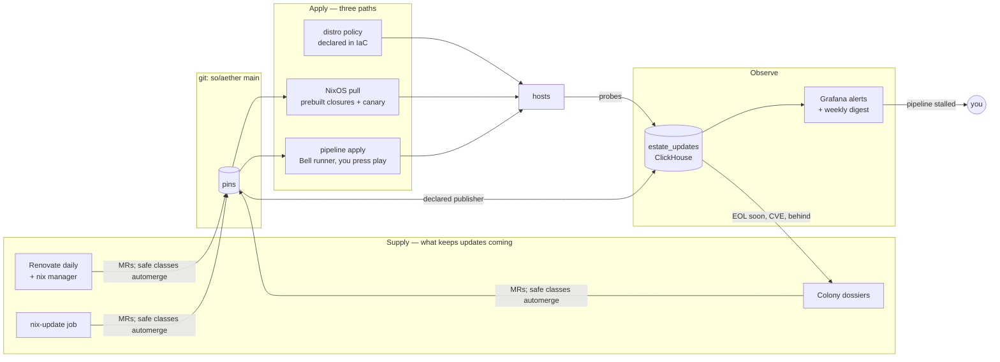
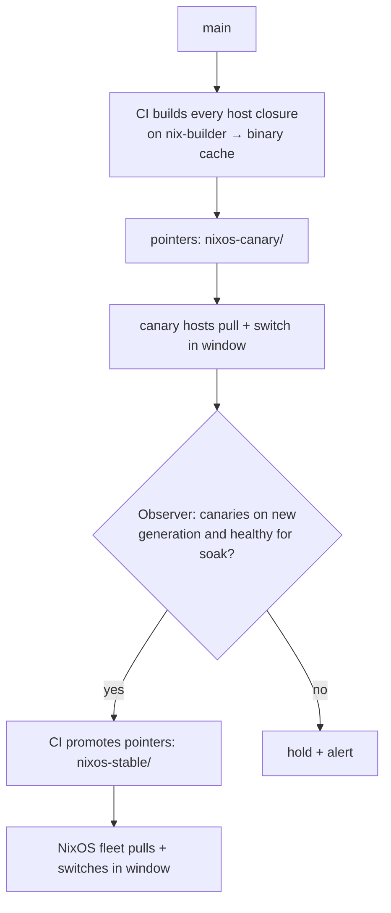

# Estate Updates (Custos) — Design Spec v2

Status: **design, awaiting review** (2026-10-30). Supersedes
[patch-management.md](patch-management.md) and v1 of this document (Cadence,
commits `ec76c86`, `1fd87cf`).

Custos (Latin *custos*, "keeper") keeps every host and workload in the estate
current and keeps vulnerabilities fixed. It works the GitOps way:

> **Rule 0 — versions change only in git.** Renovate, Colony or a human change
> a version by committing a pin. Platforms reconcile running state to git.
> Custos observes running state and proves that it matches git.

## 1. Why — evidence from 2026-10-30

| Finding | Failure class | Caught by |
| --- | --- | --- |
| VyOS running `2025.08.02-rolling`; pin bumped to `2026.07.28` on 2026-08-15 (cf3e381) and never applied | pin in git, never applied | Observer `DECLARED_NOT_APPLIED` |
| NixOS hosts built from `nixos-25.11` locked 2026-01-03; the release is past support | nobody bumps pins | Supply (Renovate, EOL dossiers) + `EOL` |
| AWS gateway on AL2023 `2023.11.20260413`, 26 weeks uptime, no update mechanism, SSH open to the internet | unmanaged host | Policy in IaC + `BEHIND` |
| OCI box: security updates installed, kernel six versions behind for 15 weeks | installed ≠ running | `PENDING_ACTIVATION` |
| GCP box: same, five kernels behind | installed ≠ running | `PENDING_ACTIVATION` |
| `dnf --releasever=latest check-update` OOM-wedged the 1 GB AWS box twice (~26 min public outage) | unsafe operation on a small host | Probe reads cached metadata only; resource guard in jobs |
| `task provision:router` from a laptop on VLAN 4 deletes the router the laptop routes through | controller cuts its own path | Apply runner on the Bell network (§9) |

## 2. Goals and non-goals

Goals:

1. Every update-bearing subject has an observed running version, a declared
   version, the latest version on its track, an EOL date and its open
   vulnerabilities — in ClickHouse, alertable in Grafana.
2. New versions arrive as commits without anyone remembering to look; safe
   classes merge themselves after CI passes.
3. Merged versions reach running state through a small number of boring apply
   paths, none of which depend on a laptop or on the router being up.
4. Vulnerabilities are prioritized by exploitability and exposure and fixed
   within SLAs.
5. Long-lived Fedora guests converge on NixOS, where the whole system is one pin.
6. The supply pipeline itself is monitored: if updates stop arriving, it pages.

Non-goals:

- General infrastructure CD for new services or topology changes (the existing
  `task` workflow keeps them).
- Replacing Trivy, Inquest, Colony or Kestra; Custos uses them.
- A custom orchestration engine. Deferred as an optional reconcile-only
  extension (§15), built only if evidence demands it.

## 3. Design invariants

1. **Rule 0.** No component installs a version that is not declared in git, except
   the explicit mutable-host exception (§10.3), where git declares the policy and
   the Observer records the versions.
2. **Running beats declared.** A merged MR is not an applied change; status is
   computed from observed state.
3. **Installed is not running.** Kernel, VyOS image, NixOS generation and image
   digest are compared at the running level.
4. **Observation is cheap and safe.** Probes read cached package metadata only,
   run under `MemoryMax=128M`, `CPUQuota=20%`, `Nice=19`, and never refresh
   metadata.
5. **Applies never cut their own path.** Anything that disrupts the router,
   GitLab, k8s or a Proxmox node runs from the Bell-network runner (§9) and does
   not need the disrupted thing to finish or roll back.
6. **Credentials exist only for the job you started.** Apply credentials are
   minted per job from the job's identity and your user; the runner holds none.
7. **Disruptive jobs: snapshot first, gate after, undo on failure.**
8. **Resource guard.** Package operations on hosts with < 2 GiB RAM run with
   temporary swap and a memory ceiling.
9. **One disruption per failure domain** (e.g. never both AdGuards).
10. **Missing data is not health.** No fresh observation = `STALE`.

## 4. Architecture



| Part | What | Runs where | Custom code |
| --- | --- | --- | --- |
| Observe | probes, platform observer, declared publisher, catalog, CVE ingest, status view, alerts | hosts; k8s CronJobs; CI | `so/custos` Rust workspace |
| Supply | Renovate, `nix-update` job, Colony dossiers, weekly digest | GitLab CI schedules; Colony; Kestra | config + one flow |
| Apply | NixOS pull, pipeline jobs on the Bell runner, distro policy | hosts; `custos` VM; existing playbooks | `custos-pull` NixOS module, CI jobs |
| Policy | `config/updates.yml` | this repo | policy crate (validation) |

`so/custos` follows the in-house Rust conventions (`crates/*` + `bins/*`,
edition 2024, pinned toolchain, versioned GitLab generic packages with sha256,
consumed under the pinned-release contract of
`ansible/roles/vyos_exporter/tasks/main.yml`). Aether owns deployment,
schemas, policy, alerting, CI and credentials.

## 5. Subjects

A **subject** is one versioned thing on one target: `"<target>/<kind>[/<name>]"`,
e.g. `link/os`, `rama/kernel`, `router/vyos-image`, `adguard/nixos-generation`,
`k8s/immich/image/server`, `k8s/chart/cilium`, `talos/os`, `talos/kubernetes`.

| Kind | Observed from | Declared in git | Upstream / track | Apply path |
| --- | --- | --- | --- | --- |
| `nixos-generation` | probe: running `configurationRevision`, booted vs current system | `flake.lock` | channel head; endoflife.date | NixOS pull |
| `vyos-image` | probe on router: `show version` | `pack_vyos.yml` ISO URL | GitHub `vyos/vyos-nightly-build` | pipeline job |
| `talos-os`, `kubernetes` | Talos/k8s API | `cloud_images.tf`, `talos_cluster.tf` | GitHub releases, `dl.k8s.io/release/stable.txt` | pipeline job |
| `chart`, `image` | Helm release, pod image digest | `tofu/home/kubernetes/*.tf` | chart `index.yaml`, registry tag → digest | pipeline job (`tofu apply`) |
| `binary` | probe: `--version` | role defaults (`vyos_exporter_version`, …) | GitLab package registry | pipeline job (ansible) |
| `os` release | probe: `/etc/os-release`, AL2023 release, `pveversion` | AL2023 `releasever`, Fedora `releasever` (`ansible/roles/dnf`), tofu image | endoflife.date; AL2023 releases | pipeline job |
| `kernel`, `packages` | probe: running vs installed, pending / pending-security counts | policy only (§10.3) | distro | distro policy |
| `platform` | probe: OS family | policy `platform_target` | — | NixOS migration (§13) |
| `vulnerability` | Trivy, vulnix, SBOM scans, distro advisories (§12) | — | OSV/NVD, CISA KEV, EPSS | via the subject it belongs to |

## 6. Policy — `config/updates.yml`

One declarative file read by the Observer, CI and the apply jobs:

```yaml
target_defaults:
  platform_target: nixos           # guests excluded in §13 override this

windows:                           # when pull/pipeline reboots may happen
  nightly: { cron: "0 4 * * *", duration: 2h, tz: America/Toronto }
blackouts:
  - { name: pbs-nightly, cron: "0 2 * * *", duration: 90m }

failure_domains:
  dns-lan: [adguard, adguard-secondary]

classes:
  nixos-lock:     { merge: auto, apply: pull, canary: [nix-builder, adguard-secondary], soak: 24h }
  nixos-release:  { merge: review, dossier: true, eol_warning: 60d }
  image-stateless: { merge: auto, apply: pipeline }
  image-stateful: { merge: review, apply: pipeline }
  chart:          { merge: review, apply: pipeline }
  provider:       { merge: auto-patch, apply: pipeline }
  vyos:           { merge: review, dossier: true, apply: pipeline, behind_max_age: 60d }
  talos:          { merge: review, dossier: true, apply: pipeline }
  kubernetes:     { merge: review, dossier: true, apply: pipeline }
  al2023-release: { merge: review, apply: pipeline }
  distro-patch:   { apply: policy, security_pending_max_age: 7d, pending_activation_max_age: 7d }

cve_sla:                           # §12
  kev_or_critical_exposed: 72h
  high: 14d
  default: next-update

targets:
  link:     { spof: true, ram_mib: 1024, exposed: [22/tcp, 443/tcp, 51820/udp] }
  vigilant: { ram_mib: 969 }
  router:   { spof: true }
  keycloak: { spof: true }
  openbao:  { spof: true }
  step-ca:  { spof: true }
  home-gateway-stack: { spof: true }
  monitoring-stack:   { spof: true }
  bazzite-builder:    { platform_target: fedora }

declared:                          # extractors for the declared publisher
  router/vyos-image: { file: ansible/playbooks/home_router/pack_vyos.yml, regex: 'vyos-(?P<v>[0-9.]+-[0-9]+-rolling)-generic' }
  talos/os:          { file: tofu/home/cloud_images.tf, hcl_local: talos_version }
  talos/kubernetes:  { file: tofu/home/talos_cluster.tf, hcl_local: kubernetes_version }
  "*/nixos-generation": { file: flake.lock, json: .nodes.nixpkgs.locked.rev }
```

CI validates the file (unknown classes/targets, targets missing from inventory
or tofu, overlapping failure domains, windows crossing blackouts).

## 7. Observe

### 7.1 `custos-probe` (host side)

Static Rust binary on an hourly timer; one JSON envelope per subject.

| Platform | Facts |
| --- | --- |
| Fedora | os-release, running vs newest kernel, `needs-restarting -r`, `dnf -C updateinfo --security` (with CVE ids), pending count, last transaction |
| Debian / Ubuntu / Proxmox | os-release, `pveversion -v` on PVE, running vs newest kernel, `/var/run/reboot-required(.pkgs)`, `apt-get -s upgrade` split by `-security` origin (existing lists only), last upgrade |
| AL2023 | release, `dnf check-release-update` (never `--releasever=latest`), kernel running vs installed |
| NixOS | `nixos-version --json`, `/run/booted-system` vs `/run/current-system`, `custos-pull` state |
| VyOS | `show version`, installed images, default boot image |
| any | podman image digests, in-house binary versions |

```json
{"v":1,"observed_at":"2026-10-30T23:40:00Z","target":"rama","subject":"rama/kernel",
 "kind":"kernel","running":"7.0.0-1013-oracle","installed":"7.0.0-1013-oracle",
 "pending":0,"pending_security":0,"reboot_required":false,"probe_version":"0.1.0"}
```

Transport reuses existing pipes: structured journald entries
(`SYSLOG_IDENTIFIER=custos-probe`) shipped by `vm_monitoring_agent`,
`otel-agent.nix` and the journal forwarder (Proxmox hosts, cloud boxes —
`monitoring_stack/journal_forwarder.yml`); on VyOS, NDJSON tailed by the
router's collector like `router-drift`. Deployed by ansible role
`custos_probe` (pinned + sha256), NixOS module `nix/modules/custos-probe.nix`,
and a VyOS task-scheduler entry.

### 7.2 `custos-observer` (platform side)

k8s CronJob, every 30 min: Talos and k8s versions, every pod's image + digest,
Helm chart versions, Proxmox guest list (PVE API, `PVEAuditor`) to catch
undeclared guests, cloud instance metadata. Emits the same envelope via OTLP.

### 7.3 `custos-declared` (repo side)

CI job on every merge to `main` (and `task publish:estate-declared`, mirroring
`publish:router-declared`): applies the `declared:` extractors plus generic
extraction of chart versions and image refs; writes rows keyed by commit.

### 7.4 `custos-catalog` (upstream side)

k8s CronJob, every 6 h: latest per track, EOL dates (endoflife.date, else
policy `eol:`), registry tag → digest resolution, CISA KEV and EPSS feeds.

### 7.5 ClickHouse — `estate_updates`

New file `ansible/playbooks/monitoring_stack/clickhouse/20-estate-updates.sql`,
same reconcile pattern as `09-vyos-observations.sql`:

| Table | Key | Retention |
| --- | --- | --- |
| `observations` | `(subject, observed_at)` | 180 d |
| `declared` (+ history) | `(subject)` / `(subject, commit)` | forever |
| `upstream` | `(track_id)` | 365 d |
| `vulnerabilities` | `(subject, vuln_id, observed_at)` | 365 d |
| `pipeline_events` | `(source, ts)` — Renovate runs, merges, promotions, apply jobs | 730 d |
| `status` (view) | latest observation ⨝ declared ⨝ upstream ⨝ vulnerabilities ⨝ policy | — |

`grafana_readonly` gets SELECT; writers are the central collector, CI and
CronJob identities.

### 7.6 Status states (most severe wins)

| State | Condition |
| --- | --- |
| `STALE` | no observation within 2 × interval |
| `CVE_SLA_BREACH` | a fixable vulnerability older than its SLA |
| `EOL` / `EOL_SOON` | track EOL passed / within `eol_warning` |
| `DECLARED_NOT_APPLIED` | declared ≠ running > 24 h after the declared row |
| `PENDING_ACTIVATION` | installed ≠ running > SLO |
| `CVE_FIXABLE` | fixable vulnerability within SLA |
| `SECURITY_PENDING` | distro security updates pending > SLO |
| `BEHIND` | upstream newer on track > SLO |
| `UNMANAGED` | observed subject or guest with no policy entry |
| `MIGRATION_PENDING` | informational: `platform` ≠ `platform_target` |
| `CURRENT` | none of the above |

### 7.7 Alerts, dashboard, digest

Rules in `tofu/home/kubernetes/grafana/alerting/rules/estate-updates.yml`;
`spof=true` or `CVE_SLA_BREACH` routes to Inquest. **Supply health** rules
(§8.6) live in the same file. Dashboard **Estate Freshness**: target × kind
grid coloured by state, EOL timeline, CVE SLA board, pipeline health,
migration burn-down. A weekly Kestra flow posts a digest to ntfy: open MRs,
due runbooks, upcoming EOLs, SLA risks.

## 8. Supply — what keeps the updates coming

### 8.1 Renovate

Self-hosted Renovate as a daily GitLab CI schedule on `so/aether`, running
inside the repo's `nix develop` shell (the Nix manager shells out to `nix`).
Renovate and diun were decommissioned before (`docs/namespace-strategy.md`
Appendix A, reason unrecorded), so noise control is part of the design:
one daily run, MRs grouped by class, the dependency-dashboard issue, automerge
for safe classes.

| Manager | Covers |
| --- | --- |
| `nix` (beta, opt-in `"nix": {"enabled": true}`) | `flake.lock` input updates on the same branch (`nixpkgs` on `nixos-25.11`, `sops-nix`, `quadlet-nix`, `disko`, …) and `lockFileMaintenance` |
| `terraform` | providers, `helm_release.version` |
| `ansible-galaxy` | `ansible/requirements.yml` |
| custom regex managers | VyOS ISO URL (`github-releases` on `vyos/vyos-nightly-build`), `talos_version`, `kubernetes_version`, in-house binary pins (GitLab packages), image refs in `*.tf` and quadlet templates, AL2023 `releasever` (custom datasource; verify in Phase 2) |

Vulnerability fast-track: Renovate's vulnerability alerts (OSV-based where the
manager supports it) open security MRs immediately, outside the schedule.

Not covered by Renovate, by design:

- **NixOS release jumps** (`nixos-25.11` → `nixos-26.05` in `flake.nix`): the
  `nix` manager's only datasource is `git-refs` and new release branches are not
  documented as detectable; release jumps go through a dossier (8.3).
- **Pinned sources inside Nix code** (overlays such as `seaweedfs` 4.38 and
  `nuclei` 3.11.0 in `flake.nix:84-121`): Renovate cannot recompute Nix hashes
  (8.2).

### 8.2 `nix-update` job

Weekly CI schedule: runs `nix-update` per overlay package declared in policy,
which updates version and source hash together, builds, and opens one grouped
MR. Fallback if the Renovate `nix` manager misbehaves: the same job runs
`nix flake update` and opens a grouped lock MR through the GitLab API.

### 8.3 Colony dossiers

Triggered by the Observer for `dossier: true` classes on `BEHIND` / `EOL_SOON`,
and for any `CVE_FIXABLE` that needs an applicability judgement. A Kestra flow
opens a Colony scope (manual approval) whose output is one MR with the pin
change plus `docs/updates/<date>-<subject>.md`: changelog digest, breaking
changes checked against live config, CVE applicability, and the runbook for
the pipeline job. This is the 2026-10-30 VyOS analysis, made repeatable.

### 8.4 Merge policy

| `merge:` | Meaning |
| --- | --- |
| `auto` | Automerge when CI is green and the CI vulnerability diff introduces no critical |
| `auto-patch` | Automerge patch updates only |
| `review` | MR for you; never automerged |

### 8.5 CI validation (every MR)

`nix build` of every `nixosConfigurations` host (on `nix-builder`), `tofu plan`
per stack, `ansible-playbook --syntax-check`, policy validation, and a
vulnerability diff: `vulnix` on each built NixOS closure, Trivy on changed
images, Trivy on the VyOS SBOM for VyOS bumps. The MR is annotated with
"fixes N / introduces M".

### 8.6 Supply health

The pipeline is a subject too. Alerts when: Renovate's last successful run is
older than 2 d; an update MR is open longer than 14 d; `nixos-canary` is held
longer than 3 d; `nixos-stable` lags `main` more than 7 d; any
`DECLARED_NOT_APPLIED` exceeds its grace; the weekly digest failed to send.

## 9. The Bell-network runner (`custos` VM)

A NixOS VM on **niobe** (not oracle, which hosts the router), local disk, two
legs: the Gigahub segment `192.168.2.0/24` (own internet uplink; reaches the
Proxmox hosts, the router at `.231`, PBS `.233`, step-ca `.235`, both AdGuards)
and VLAN 2 (L2-adjacent to OpenBao `10.0.2.9`, the home gateway `10.0.2.2` and
ClickHouse `10.0.2.3` without transiting VyOS). Addresses are allocated in
`config/vm.yml`; tofu `tofu/home/custos.tf`; NixOS `nix/hosts/niobe/custos/`.

It runs one GitLab runner. Four rules make that safe:

| Rule | Mechanism |
| --- | --- |
| Only `main` pipelines | runner marked **protected**, locked to `so/aether`, tag `bell` |
| Only apply jobs | validation/plan/build jobs stay on the existing k8s and `gitlab` VM runners; only `when: manual` apply jobs carry `tags: [bell]` |
| Credentials only for a job you started | the job's `id_token` logs into OpenBao JWT auth; roles bind `project_path=so/aether`, `ref_protected=true`, `environment=<stack>`, `user_login=shdrch`; tokens live for the job |
| No dependency on GitLab mid-run | GitLab is `10.0.3.7` on VLAN 3, behind the router. Disruptive jobs stage everything, then hand off to a local systemd unit that runs snapshot → change → gates → undo; the CI job reconnects and reports; results also go to ClickHouse over VLAN 2 |

Its own node: niobe's reboot in a Proxmox rolling job migrates `custos` first
(`--with-local-disks`) or is done last by hand. The VM updates itself through
NixOS pull, never while a job is running.

## 10. Apply — three paths



### 10.1 NixOS pull (no runner, no central credentials)

- CI on `main` builds every host closure on `nix-builder` and serves them from a
  new binary cache there (harmonia, signed; public key in `nix/modules/base.nix`).
  No cache exists today.
- CI publishes a pointer per host and channel (`nixos-canary/<host>`,
  `nixos-stable/<host>`): the store path of that host's system.
- Module `nix/modules/custos-pull.nix` on every host: in its window, fetch the
  pointer, verify the closure is signed and names this host, `nix copy` from the
  cache, set the system profile, `switch-to-configuration` (or `boot` + reboot
  when the kernel changed). Hosts never evaluate nixpkgs themselves: step-ca and
  openbao have 512 MiB.
- Promotion: a scheduled CI job fast-forwards `nixos-stable` pointers only when
  the Observer reports every canary on the new generation and healthy for
  `soak`. Rollback = revert commit, or the previous generation on the host.
- Prior art: Cachix Deploy agent, `comin`, `system.autoUpgrade`; the custom
  module exists only because hosts must not evaluate locally.

### 10.2 Pipeline apply on the Bell runner (you press play)

Manual jobs on `main`, one per stack or job type:

| Job | Does |
| --- | --- |
| `apply:tofu:<stack>` | `tofu apply` of the plan artifact from the validated pipeline (`home`, `aws`, `google`, `oci`, `kestra-flows`) |
| `apply:ansible:<playbook>` | non-disruptive playbooks (in-house binaries, quadlet image bumps) |
| `apply:router` | detached unit: `add system image` from the pinned ISO URL → `set default-boot` → reboot → gates (WAN, VLANs, WireGuard, DNS, probes) → on failure `set default-boot <previous>` + reboot |
| `apply:pve-rolling` | per node: migrate guests → apt full-upgrade → reboot → gates → migrate back; one node at a time |
| `apply:talos` / `apply:kubernetes` | `talosctl upgrade` per node / `upgrade-k8s`, then the pin already matches |
| `apply:link-release` | Lightsail snapshot → swap guard → `dnf upgrade --releasever=<pinned>` → reboot → gates (units, WireGuard peers, SNI checks from two vantages) |

Every disruptive job: snapshot first, gates after, undo on failure,
`pipeline_events` rows throughout. Colony dossiers write the runbook these
jobs encode; new job types are added through review like any code.

### 10.3 Distro policy (the mutable-host exception)

For hosts whose package versions cannot be pinned in git, IaC declares the
policy and the Observer records the outcome:

| Hosts | Policy (declared in IaC) |
| --- | --- |
| Fedora non-SPOF (until migrated) | `ansible/roles/dnf`: `dnf-automatic` security updates; staggered reboot windows |
| Fedora SPOF: keycloak, step-ca, openbao, home-gateway, monitoring | `dnf-automatic` download-only; installed and rebooted by an `apply:ansible:patch-spof` job, one per window. Ends today's unattended 05:00 self-reboots of identity and ingress |
| `vigilant` (Debian), `rama` (Ubuntu) | new role `unattended_upgrades`: security origin, automatic reboot in staggered windows |
| Proxmox hosts | `unattended_upgrades` download-only; installed by `apply:pve-rolling` |
| `link` (AL2023) | `releasever` pinned in git; patches within the release via `dnf-automatic` security; release jumps via `apply:link-release` |

The exception shrinks as guests move to NixOS (§13).

## 11. Agents

| Agents do | Agents never do |
| --- | --- |
| Research changelogs; check breaking changes and CVE applicability against live config (Colony dossiers) | Merge, apply, or hold credentials |
| Write runbooks for new pipeline job types | Decide rollback |
| Triage failed jobs (Inquest / Holmes) | Write to `estate_updates` |

## 12. Vulnerabilities

| Class | Source | When |
| --- | --- | --- |
| k8s images | Trivy operator (deployed; fix the churn and failing scans recorded in `docs/namespace-strategy.md` Appendix A) | running |
| NixOS hosts | `vulnix` on each built closure | CI, before deploy |
| VyOS | the `.cdx.json` / `.spdx.json` SBOM published with each rolling build, scanned with `trivy sbom` | running build vs candidate |
| AL2023, Debian, Ubuntu | `trivy rootfs` from the probe host (Trivy's OS coverage lists these; its docs list Debian up to 12, so Debian 13-based PVE 9 uses `debsecan`) | probe |
| Fedora (until migrated) | `dnf updateinfo` advisories with CVE ids from cached metadata (Trivy has no Fedora support) | probe |
| In-house Rust | `cargo-deny` in their CI; Trivy on their images | their CI |

Prioritization: severity × CISA KEV × EPSS × exposure (policy `exposed:`,
cross-checked with `estate_scan` results) × applicability (Colony, for gated
classes). Fixable + high priority → Renovate vulnerability MR now, or a Colony
dossier with a due date; unfixable → tracked and alerted, no MR. SLAs from
policy `cve_sla`; breaches page. Automerge is blocked when the CI
vulnerability diff introduces a critical.

## 13. Fedora → NixOS convergence

Direction and Definition of Done: [docs/nixos.md](../nixos.md). Order by blast
radius, one guest per window:

| Wave | Guests | Notes |
| --- | --- | --- |
| 1 | `vyos-packer` → **retire** (build the VyOS image on `nix-builder`); `notifications-stack` | small state |
| 2 | `iot-management-stack`; `nfs` | USB hand-over; storage needs its own case-by-case plan first |
| 3 | `step-ca`, `openbao`, `keycloak` | tier-0, one per window, state copy + tested restore |
| 4 | `home-gateway-stack` | ingress SPOF; keep-IP cutover pattern |
| 5 | `monitoring-stack` | Track B in [monitoring-stack-nix.md](monitoring-stack-nix.md) |
| 6 | `gitlab` | largest state; last so CI stays stable |

Stays: `bazzite-builder`, router, Talos, Proxmox. Cloud boxes: GCE and OCI
accept custom images, so `vigilant` and `rama` are later candidates; whether
Lightsail can run NixOS must be verified before `link` is considered.

Recipe per guest (ids-stack / Track B pattern): host config + flake entry +
Taskfile path → blue guest beside green in tofu → two-phase state copy → gates
→ `config/vm.yml` IP/vmid swap → soak → remove green after the DoD.
Prerequisite: `nixpkgs` on the current stable release before wave 1. Each
migrated guest leaves the §10.3 exception for NixOS pull; `MIGRATION_PENDING`
is the burn-down.

## 14. Rollout

| Phase | Delivers | Acceptance |
| --- | --- | --- |
| 0 — backlog (manual) | router to current rolling; `nixpkgs` → current stable; Proxmox host patching | these subjects `CURRENT` once Phase 1 lands |
| 1 — Observe | probe, observer, declared, catalog, schema, status, alerts, dashboard; vulnerability ingest from Trivy operator and probe advisories | every inventory target and k8s workload observed; replayed §1 fixtures produce the right states; one real alert routes |
| 2 — Supply | Renovate (+ `nix`, custom managers, vulnerability alerts), `nix-update` job, merge policy, CI validation + vulnerability diff, Colony dossier flow, supply-health alerts, weekly digest | a week of grouped MRs with automerge on safe classes; one VyOS dossier comparable to 2026-10-30 |
| 3 — Apply foundation | `custos` VM + protected runner + OpenBao JWT roles; `apply:tofu:*`, `apply:ansible:*`; binary cache + pointers + `custos-pull` + canary promotion; §10.3 policies in IaC | a Renovate `flake.lock` MR reaches every NixOS host via canary without a human; a tofu stack applies from the Bell runner with job-scoped creds |
| 4 — Disruptive jobs | `apply:router`, `apply:pve-rolling`, `apply:talos`, `apply:kubernetes`, `apply:link-release` | router upgrade with automatic fallback on gate failure; a PVE rolling reboot across 5 nodes; game day with the router down |
| 5 — CVE prioritization | KEV/EPSS/exposure scoring, SLAs, automerge blocking, SBOM and `trivy rootfs` scans | SLA board live; a seeded critical blocks automerge |
| M — NixOS waves (parallel from Phase 1) | §13 waves 1–6 | each guest meets the DoD; `MIGRATION_PENDING` reaches 0 in scope |

## 15. Deferred extension — reconcile-only conductor

If, after Phase 4, pressing play is the bottleneck (most likely monthly Proxmox
rolling reboots and SPOF patching), add a reconcile-only daemon on the `custos`
VM that starts the same pipeline jobs for `auto` classes inside windows. It may
only bring running state to what git declares (Rule 0); it never picks versions.
Design notes from v1 that carry over: typed actions with undo, plan validator
with the path invariant, gates against ClickHouse. Build only with evidence.

## 16. Alternatives considered

| Option | Why not |
| --- | --- |
| Custom conductor + approval UI + minted credentials (v1) | Largest build and security surface for a few dozen gated events a year; protected runner + JWT binding gives the same approval and scoping with stock GitLab/OpenBao |
| Apply on merge with standing CI credentials | Merged code (including automerged) would get privileged credentials without a human; runners sit behind the router |
| Kestra as the apply engine | Runs in k8s behind the router; kept as scheduler for catalog, dossier and digest flows |
| AWX / Semaphore / Rundeck | Another UI and credential store wrapping the same Ansible; GitLab already provides jobs, logs and approval-by-play |
| Hosts run `system.autoUpgrade` | Evaluates nixpkgs on the host (OOM on 512 MiB guests) and has no canary gate |
| Fleet/osquery for observation | Being decommissioned (`monitoring-stack-nix.md` A9); journald/OTel already covers every host class |

## 17. Decisions (conservative defaults)

- Name `custos`; repo `so/custos`; Rust; ClickHouse database `estate_updates`.
- Bell runner VM `custos` on niobe, NixOS, local disk, Gigahub + VLAN 2 legs.
- SPOF hosts never patch or reboot themselves; they patch through jobs.
- Renovate `nix` manager is beta: Phase 2 keeps the `nix flake update` fallback job ready.
- NixOS release jumps and VyOS/Talos/k8s bumps always go through dossiers.
- Fedora → NixOS by blast radius; identity services one per window.
- `vyos-packer` is retired, not migrated.
